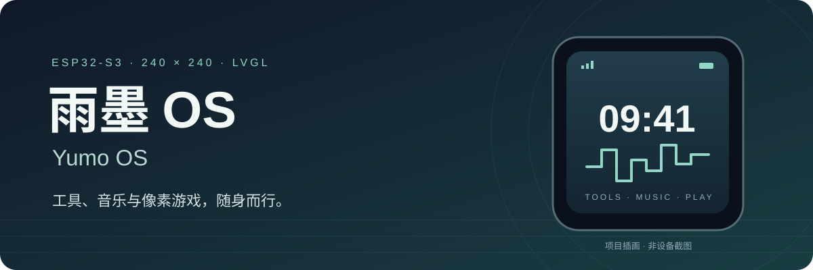
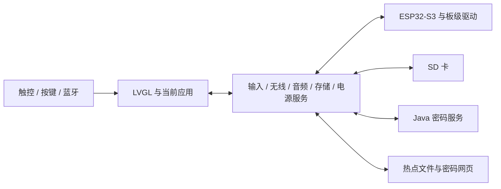

<p align="center">
  
</p>

<h1 align="center">雨墨 OS · Yumo OS</h1>

<p align="center">一块 240 × 240 小屏，装下工具、音乐与像素游戏。</p>
<p align="center"><strong>ESP32-S3 · ESP-IDF · LVGL · C/C++ · Java 8</strong></p>

<p align="center">
  <a href="#快速开始">快速开始</a> ·
  <a href="docs/firmware/overview.md">25 个应用</a> ·
  <a href="docs/firmware/hardware.md">硬件</a> ·
  <a href="docs/README.md">文档</a> ·
  <a href="docs/validation.md">验证范围</a>
</p>

Yumo OS 是面向 **ESP32-S3-Touch-LCD-1.54** 的便携式触屏系统。应用按需加载，退出释放资源；支持多主题、实体按键、蓝牙输入、SD 卡和统一屏幕旋转。

**A compact touchscreen system for ESP32-S3**, combining a password vault, local MP3 playback, NES games, SD file tools, and local Wi-Fi sharing. The primary documentation is in Chinese.

## 功能一览

| 场景 | 主要功能 | 说明 |
| --- | --- | --- |
| 密码与工具 | 九点图形密码本、配套网页服务、HTTPS同步、分类与二维码、蓝牙键鼠 | [密码本](docs/firmware/password_vault.md) |
| 时间与日常 | 四面时钟、中文时钟、分段秒表、万年历、随机工具、手电筒、摩斯电码 | [应用概览](docs/firmware/overview.md) |
| 音乐与录音 | MP3/LRC歌词、8Bit合成音乐、蓝牙媒体遥控、双麦录音 | [MP3音乐](docs/firmware/mp3_music.md) |
| 游戏 | FC/NES、IINE蓝牙手柄、萌芽物语、小恐龙、重力迷宫 | [FC操作](docs/firmware/fc_touch_controls.md) · [萌芽物语](docs/firmware/garden.md) |
| 文件与图片 | SD文件管理、文本阅读、JPEG/PNG/GIF、视口缩放与SD缓存 | [图片解码](docs/firmware/photo_rendering.md) |
| 网络 | Wi-Fi自动共享、本地热点、Wi-Fi硬盘、密码查看网页、测速图表与历史 | [局域网](docs/firmware/lan_hotspot_20260920.md) · [测速](docs/firmware/speed_test.md) |
| 学习 | 编程速查（含K8s/K9s）、设计模式课程及离线资料 | [学习功能](docs/firmware/learning_files_morse.md) |
| AI对话 | 小智AI在线手动语音、官方绑定、识别文本与回答、小屏界面 | [小智AI](docs/firmware/xiaozhi_ai.md) |
| 系统 | 多主题、统一四向旋转、USB读卡器、USB投屏、休眠与时钟补偿 | [系统架构](docs/firmware/firmware_architecture.md) |

## 硬件与运行范围

- 目标板：ESP32-S3-Touch-LCD-1.54，240×240 SPI显示，16MiB Flash。
- 交互：CST816S触控、BOOT/KEY/PWR按键、QMI8658运动传感器、BLE键盘/手柄。
- 音频：ES8311扬声器输出、ES7210双麦采集；媒体与历史存放于SD卡。
- 标准板无独立RTC晶体；使用内部RTC、联网学习与离线补偿。

具体引脚及电源限制见[硬件文档](docs/firmware/hardware.md)。本项目包含板级适配，其他ESP32-S3设备需要按实际接线移植。

## 快速开始

完整步骤见[环境、初始化、编译与烧录](docs/build.md)。以下命令在仓库根目录的Windows CMD执行。

先获取源码并进入仓库目录：

```bat
git clone https://github.com/Xingjq-github/yumo-esp32-os.git
cd yumo-esp32-os
```

### 1. 准备工具

安装并激活项目固定版本的ESP-IDF、Python 3.11、JDK8和Maven。SDK、组件版本及补丁由[依赖清单](config/dependencies.json)和[依赖说明](docs/dependencies.md)约束。

### 2. 准备组件和自己的配置

```bat
python -B tooling\apply_sdk_patch.py
python -B tooling\prepare_dependencies.py
python -B tooling\init_config.py --url http://vault.local:8443
```

将示例地址替换为设备可访问的服务地址。初始化会生成本副本的双端同步密钥与存储身份，已有完整配置会被保留。详见[配置说明](docs/configuration.md)。

### 3. 编译

```bat
Build.cmd
Build-Server.cmd
```

`Build.cmd`构建设备固件及检查，`Build-Server.cmd`测试并打包Java服务；二者均不自动烧录或启动正式服务。只用服务端时无需安装ESP-IDF。

烧录方式见[烧录步骤](docs/build.md#4-手动烧录)；电脑启动见[PC服务](docs/server/pc.md)，容器部署见[NAS说明](docs/server/nas.md)。

### 4. 准备SD卡

把需要的资源目录直接放在SD卡根目录：

```text
MP3/          MP3音乐及同名 .lrc / .LRC，仅扫描这一层
nes/          自备 .nes 游戏；设备在此保存存档
pictures/     图片，可使用其他可浏览目录
txt/          文本，可使用其他可浏览目录
chiptune/     8Bit乐谱
programming/  编程资料
patterns/     设计模式课程
config/       可编辑的同步地址及FC键盘映射
```

录音、截图、测速历史及养成游戏存档由设备按需生成。资源准备、保留旧数据和取卡说明见[SD卡目录](resources/sdcard/README.md)。

## 代码结构

```text
firmware/   应用、系统服务、UI、BSP和移植组件
server/     Java 8密码服务、网页及测试
desktop/    USB投屏客户端、HTML主题演示
resources/  教学源码及SD资源模板
tooling/    构建、初始化、校验和回放脚本
config/     固定依赖及校验清单
patches/    SDK和组件适配
packaging/  PC/NAS启动与部署模板
docs/       硬件、功能、架构、构建和部署说明
```



从[学习路线](docs/learning.md)和[固件架构](docs/firmware/firmware_architecture.md)开始阅读。

## 当前版本与边界

代码更新至2026-11-02已烧录基线，包含小智AI、蓝牙鼠标异步发送与日志减负、16条蓝牙绑定、九点图形密码、公网HTTPS同步、Wi-Fi连接优化及LCD静置保护。完整状态见[当前版本](docs/current-state.md)。

- FC输出240×240，原图左右各裁8列；25/30fps为显示调度上限，不是所有游戏实测帧率。
- MP3通过本机扬声器输出；Type-C耳机与USB有线键盘功能不在当前版本中，USB读卡器和投屏保留。
- IINE C模式用于FC游戏，H模式用于设备导航；最新H返回/翻页及全部游戏效果仍需实机测试。
- 图片16MiB为输入上限，解码同时受到像素、内存和处理预算约束。
- 小智AI手动语音及蓝牙鼠标长期体验仍待实机验收；宿主回放和短时启动不等同于云端对话、音质或无线性能测试。
- 固件采用factory分区，当前没有OTA更新入口；[便携升级脚本](docs/firmware/portable_flash.md)默认仅更新系统分区，源码仓库不附带预制固件或运行时。

来源验证、宿主回放与独立构建的区别见[验证说明](docs/validation.md)。

## 参与开发与许可

问题报告请提供硬件型号、版本、复现步骤和脱敏日志；提交改动前阅读[贡献说明](CONTRIBUTING.md)。

各第三方组件保留原有许可证，详见[第三方说明](THIRD_PARTY_NOTICES.md)。仓库目前没有为项目原创部分新增统一许可证；不能把组件许可证自动扩大到整个项目。
