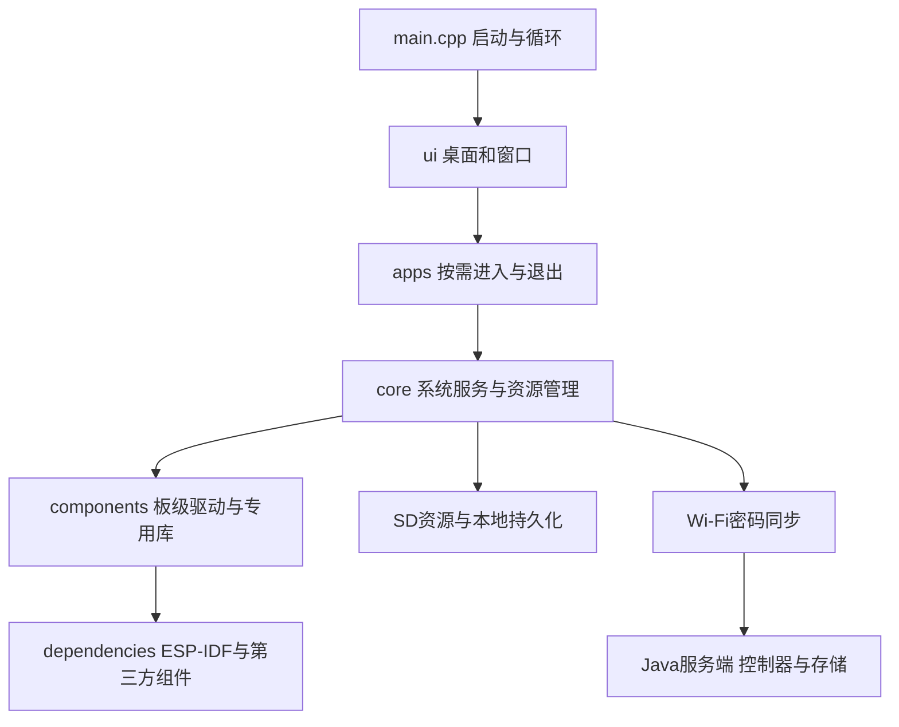

# 学习路线

建议按“入口 → 一个应用 → 共用系统服务 → 硬件”阅读，不先从整个SDK开始。

1. 打开 [main.cpp](../firmware/main/main.cpp)，了解启动顺序、应用注册和主循环。
2. 打开 [窗口管理](../firmware/main/ui/window_mgr.cpp)和[桌面](../firmware/main/ui/home_screen.cpp)，理解应用如何进入、退出以及排序。
3. 从[手电筒](../firmware/main/apps/flashlight.cpp)开始阅读一个小应用，再看[文本阅读](../firmware/main/apps/text_reader.cpp)如何使用存储、分页与按键。
4. 阅读[系统服务](../firmware/main/core/system_service.cpp)、[电源运行逻辑](../firmware/main/core/power_runtime.cpp)和[电源管理](../firmware/main/core/power_mgr.cpp)，理解设置优先级、系统活动、黑屏与休眠。
5. 阅读[音频管理](../firmware/main/core/audio_mgr.cpp)、[录音](../firmware/main/core/audio_recorder.cpp)和[SD管理](../firmware/main/core/sd_media.cpp)，重点看任务之间如何交接资源、退出后如何释放。
6. 阅读[设备密码本](../firmware/main/apps/password_vault.cpp)、[同步](../firmware/main/core/vault_sync.cpp)和[本地存储](../firmware/main/core/vault_storage.cpp)，再沿 Java 控制器进入服务端。密钥只查看引用关系，不复制到文档或日志。
7. 最后进入 `firmware/components` 的板级实现；只有需要了解具体API时再查 自行安装的 ESP-IDF 和第三方库。

## Java服务端

从 [VaultApplication](../server/src/main/java/com/joyvault/VaultApplication.java)启动入口，到 [VaultController](../server/src/main/java/com/joyvault/VaultController.java) HTTP 接口，再看 [AuthService](../server/src/main/java/com/joyvault/AuthService.java)、[VaultStore](../server/src/main/java/com/joyvault/VaultStore.java)和[VaultProtocol](../server/src/main/java/com/joyvault/VaultProtocol.java)。网页在 `server/src/main/resources/static`，测试在 `server/src/test`。

## 修改之后如何验证

固件入口运行源码契约检查与编译期模型；Java入口运行JUnit。它们用于发现路径错误、协议不一致和已覆盖逻辑回归，不替代真实设备的蓝牙连接、音频听感、SD卡操作和续航验收。不要为了让整理后的检查通过而删除有效断言或扩大原有历史排除范围。

## 新增模块阅读

- [时钟自学习](firmware/network_time.md)：从 [clock_drift_model.hpp](../firmware/main/core/clock_drift_model.hpp) 的窗口/补偿计算，再到 [clock_discipline.cpp](../firmware/main/core/clock_discipline.cpp) 的 SDK 边界和持久化交接；模型参数分辨率不能替代长期走时实测。
- [网速测速](firmware/speed_test.md)：从 [应用界面](../firmware/main/apps/speed_test.cpp) 到 [网络任务](../firmware/main/core/speed_test.cpp)、[统计模型](../firmware/main/core/speed_test_model.hpp) 和 [SD历史](../firmware/main/core/speed_test_store.cpp)，理解完整数据判定、图表快照和安全收尾。
